<p align="center">
  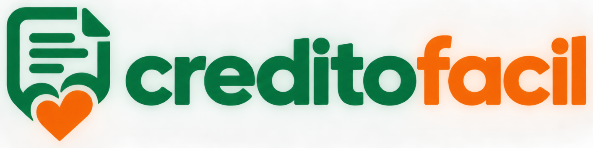
</p>

# creditofacil — Front-End (Sprint 2)

O **creditofacil** transforma o crédito de ICMS da Nota Fiscal Paulista em doação automática para a ONG **Turma do Bem**, sem custo para quem doa.
O site explica o que é o crédito, guia a pessoa, passo a passo, a ativar a doação automática no site oficial da Fazenda (sem nunca acessar a conta dela) e mostra o impacto das doações em um painel.

Projeto do Challenge FIAP 2026 · 1TDSPR · em parceria com a Turma do Bem.

## Novidades da Sprint 2

- **Layout responsivo:** o site agora se adapta a celular e tablet, além do desktop
- **Menu hambúrguer:** em telas menores, o menu abre e fecha com JavaScript, em todas as páginas
- **Validação do formulário de contato:** nome, e-mail e mensagem são obrigatórios, com aviso de erro em cada campo
- **Ajustes de semântica e acessibilidade:** títulos nas seções que não tinham heading e estado do menu informado com `aria-expanded` e `aria-label`
- **Ajustes visuais:** carregamento das fontes em todas as páginas, espaçamentos, hovers, cards de destaque e botão de upload
- **Equipe:** links dos integrantes abrem em nova aba e a lista foi atualizada

## Tecnologias

- HTML5 semântico
- CSS3 (arquivo externo único, variáveis CSS, Flexbox e Grid)
- JavaScript puro (arquivos externos em `js/`), sem framework e sem biblioteca externa
- Fontes Poppins e Source Sans 3, carregadas do Google Fonts

### Breakpoints

| Tela | Media query |
|---|---|
| Celular pequeno | `@media (max-width: 480px)` |
| Celular | `@media (max-width: 767px)` |
| Tablet | `@media (min-width: 768px) and (max-width: 991px)` |
| Desktop | `@media (min-width: 992px)` |
| Desktop grande | `@media (min-width: 1300px)` |

## Páginas

| Página | Conteúdo |
|---|---|
| `index.html` | Proposta de valor, como funciona, caminho do cupom sem CPF, dúvidas rápidas |
| `solucao-wizard.html` | Protótipo navegável do passo a passo de ativação (3 passos) e da recuperação de cupom sem CPF |
| `solucao-dashboard.html` | Protótipo do painel do doador com dados de exemplo |
| `sobre.html` | Contexto, solução, Turma do Bem, tecnologias e roadmap |
| `integrantes.html` | Equipe |
| `faq.html` | Perguntas frequentes (abre e fecha com `<details>`) |
| `contato.html` | Formulário de contato com validação em JavaScript (protótipo, sem envio) |

## Estrutura de pastas

```
.
├── index.html
├── solucao-wizard.html
├── solucao-dashboard.html
├── sobre.html
├── integrantes.html
├── faq.html
├── contato.html
├── css/
│   └── style.css
├── js/
│   ├── menu.js               # menu hambúrguer
│   └── form_contato.js       # validação do formulário de contato
├── imagens/
│   ├── integrantes/          # fotos da equipe
│   ├── prints/               # capturas de tela (Desktop, Tablet e Mobile)
│   ├── icone-nota.svg        # ícone da marca
│   └── ...                   # logos e favicons
└── README.md
```

## Imagens do projeto


### Capturas de tela

#### 🖥️ Desktop

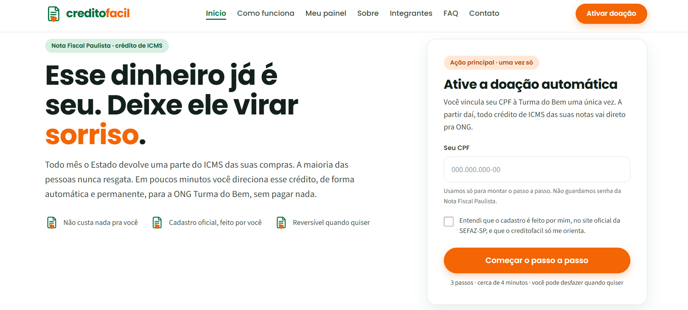
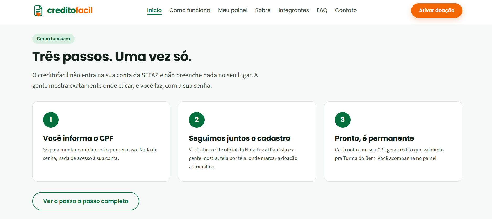
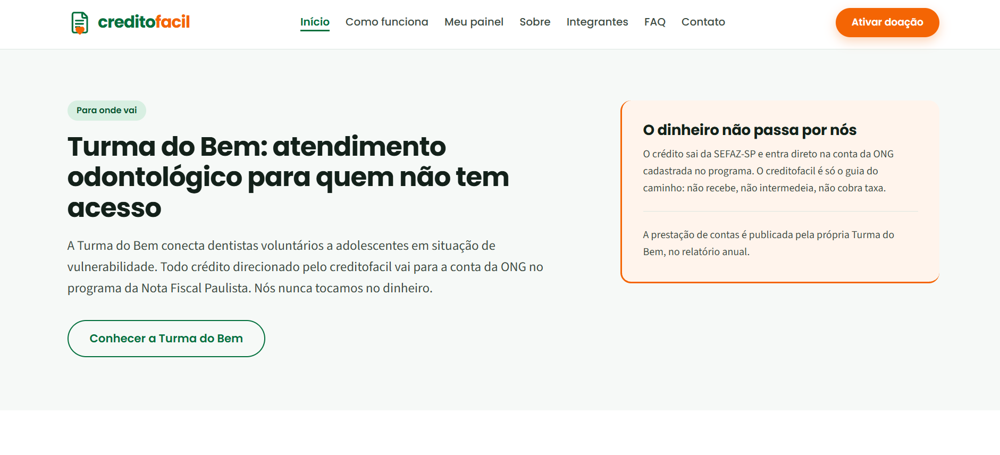
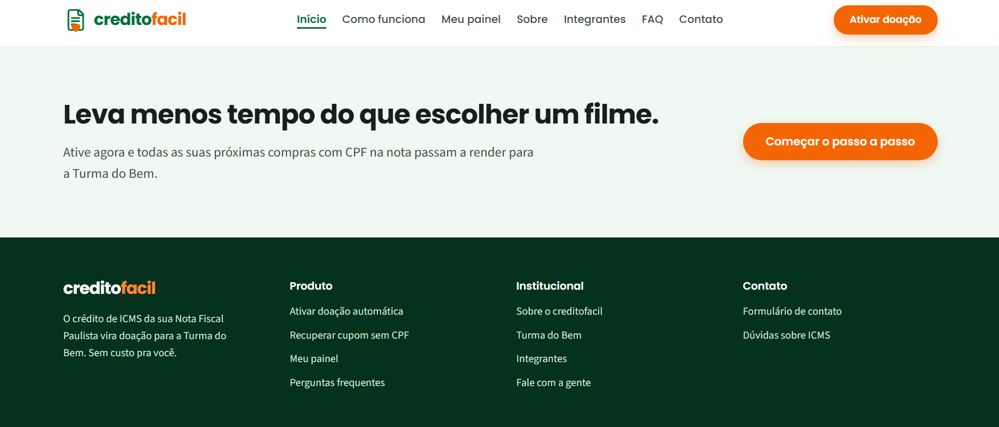
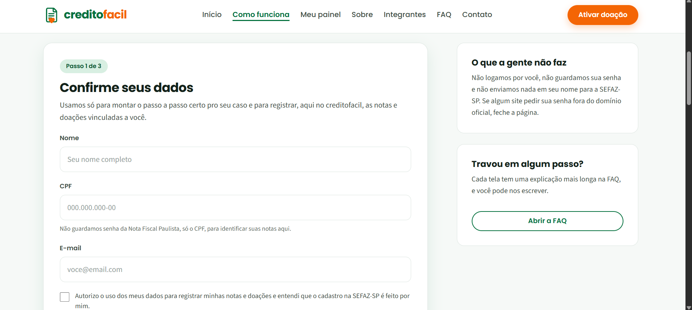
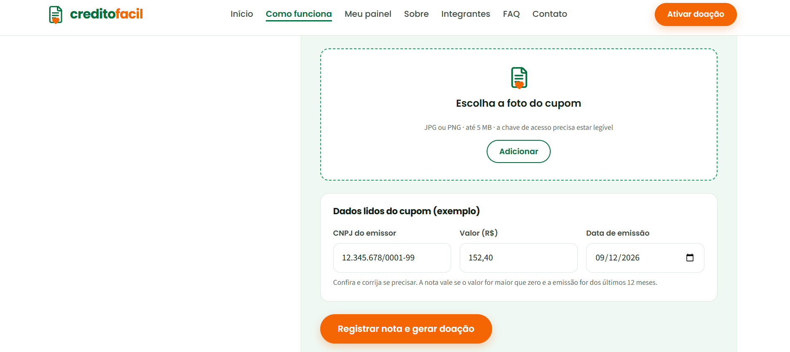
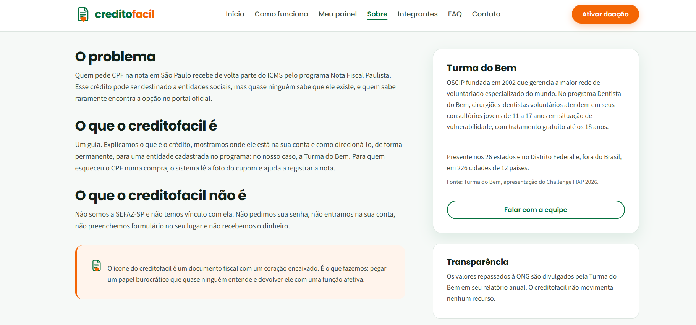
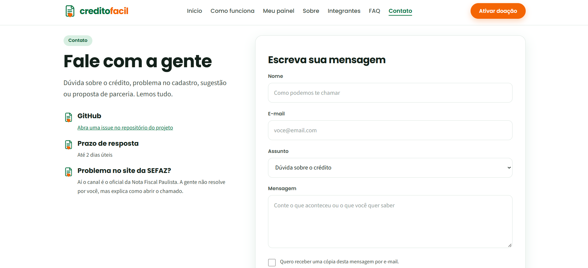

#### 📟 Tablet

<p>
  
  
</p>

#### 📱 Celular

<p>
  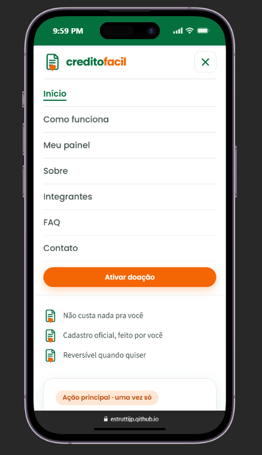
  
  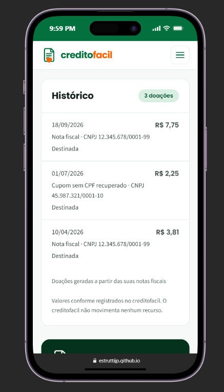
  
  
</p>


## Como abrir

Não há etapa de build. Abra o `index.html` no navegador, em qualquer tamanho de tela.

## Autores

| Foto | Nome | RM | Turma | LinkedIn | GitHub |
|---|---|---|---|---|---|
|  | João Pedro Estrutti Amaral | 575088 | 1TDSPR | [LinkedIn](https://www.linkedin.com/in/joao-pedro-estrutti/) | [GitHub](https://github.com/EstruttiJP) |
|  | João Vitor Tinem Silva | 576501 | 1TDSPR | [Linkedin](https://www.linkedin.com/in/joão-vitor-tinem-35bbb4442) | [GitHub](https://github.com/JoaoVitorTinem) |
|  | Lucas Miguel Lino | 574843 | 1TDSPR | [Linkedin](https://www.linkedin.com/in/lucas230lino) | [GitHub](https://github.com/linorepos) |
|  | Munir Foresti Assis | 569917 | 1TDSPR | [Linkedin](https://www.linkedin.com/in/munir-f-assis) | [GitHub](https://github.com/MunirAssis) |

## Links

- Repositório público: https://github.com/EstruttiJP/creditofacil-front
- Visualização do projeto (GitHub Pages): https://estruttijp.github.io/creditofacil-front/
