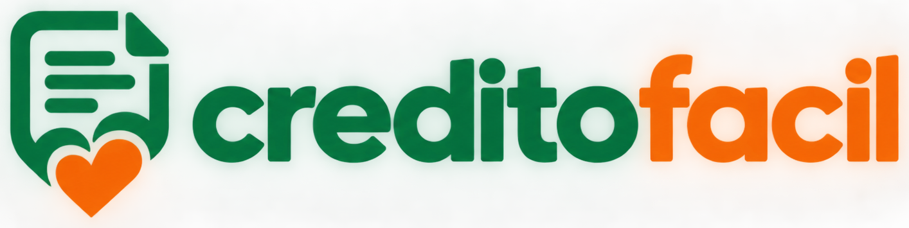

<p align="center">
  
</p>

# creditofacil — Front-End (Sprint 1)

O **creditofacil** transforma o crédito de ICMS da Nota Fiscal Paulista em doação automática para a ONG **Turma do Bem**, sem custo para quem doa.
O site explica o que é o crédito, guia a pessoa, passo a passo, a ativar a doação automática no site oficial da Fazenda (sem nunca acessar a conta dela) e mostra o impacto das doações em um painel.

Projeto do Challenge FIAP 2026 · 1TDSPR · em parceria com a Turma do Bem.

## Tecnologias

- HTML5 semântico
- CSS3 (arquivo externo único, variáveis CSS, Flexbox e Grid)
- Versão desktop: `@media (min-width: 992px)` e `@media (min-width: 1300px)`
- Sem JavaScript, sem framework e sem biblioteca externa nesta sprint

## Páginas

| Página | Conteúdo |
|---|---|
| `index.html` | Proposta de valor, como funciona, caminho do cupom sem CPF, dúvidas rápidas |
| `solucao-wizard.html` | Protótipo navegável do passo a passo de ativação (3 passos) e da recuperação de cupom sem CPF |
| `solucao-dashboard.html` | Protótipo do painel do doador com dados de exemplo |
| `sobre.html` | Contexto, solução, Turma do Bem, tecnologias e roadmap |
| `integrantes.html` | Equipe |
| `faq.html` | Perguntas frequentes (abre e fecha com `<details>`) |
| `contato.html` | Formulário de contato (protótipo, sem envio) |

## Estrutura de pastas

```
.
├── index.html
├── solucao-wizard.html
├── solucao-dashboard.html
├── sobre.html
├── integrantes.html
├── faq.html
├── contato.html
├── css/
│   └── style.css
├── imagens/
│   ├── integrantes/          # fotos da equipe
│   ├── icone-nota.svg        # ícone da marca
│   └── ...                   # logos e favicons
└── README.md
```

## Imagens do projeto


### Capturas de tela


## Como abrir

Não há etapa de build. Abra o `index.html` no navegador, em uma tela com 992 px de largura ou mais.

## Autores

| Nome | RM | Turma | LinkedIn | GitHub |
|---|---|---|---|---|
| João Pedro Estrutti Amaral | 575088 | 1TDSPR | [LinkedIn](https://www.linkedin.com/in/joao-pedro-estrutti/) | [GitHub](https://github.com/EstruttiJP) |
| João Vitor Tinem Silva | 576501 | 1TDSPR | - | - |
| Leonardo Vasconcelos Meireles Barbosa | 576492 | 1TDSPR | - | - |
| Lucas Miguel Lino | 574843 | 1TDSPR | - | - |
| Munir Foresti Assis | 569917 | 1TDSPR | - | - |

## Links

- Repositório público: https://github.com/EstruttiJP/creditofacil-front
- Visualização do projeto (GitHub Pages): https://estruttijp.github.io/creditofacil-front/
